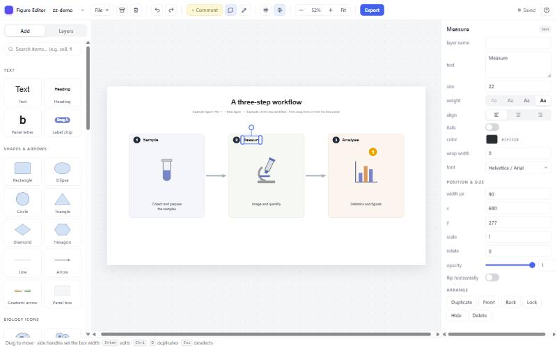
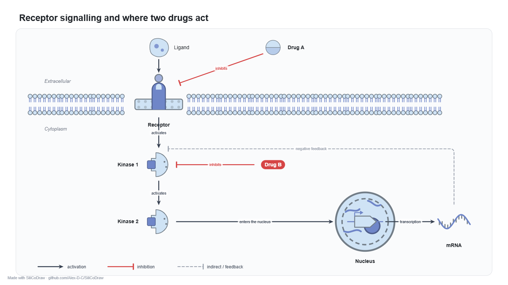
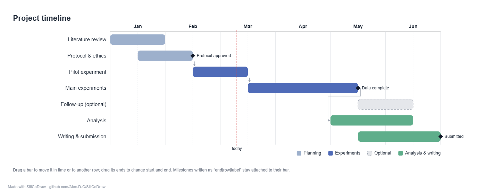
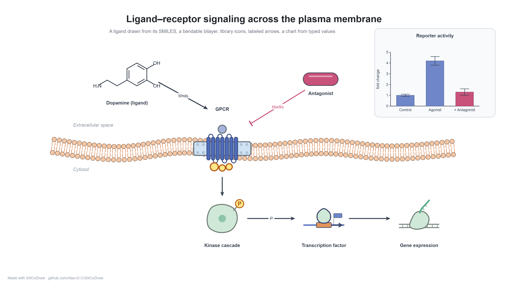
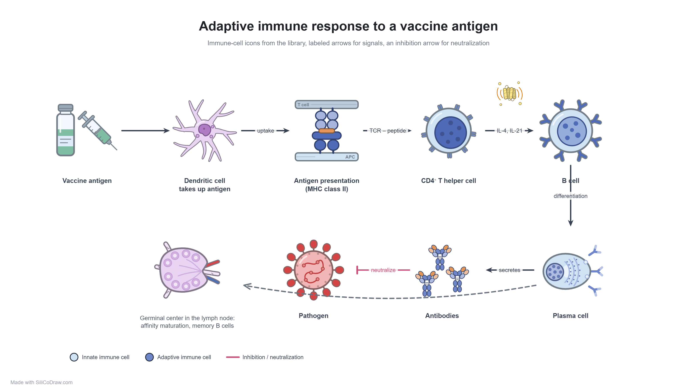
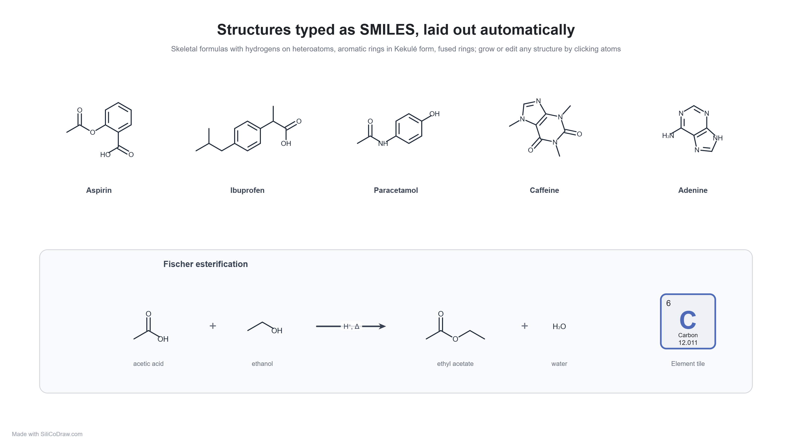
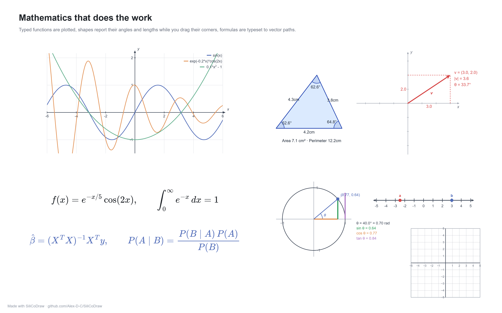
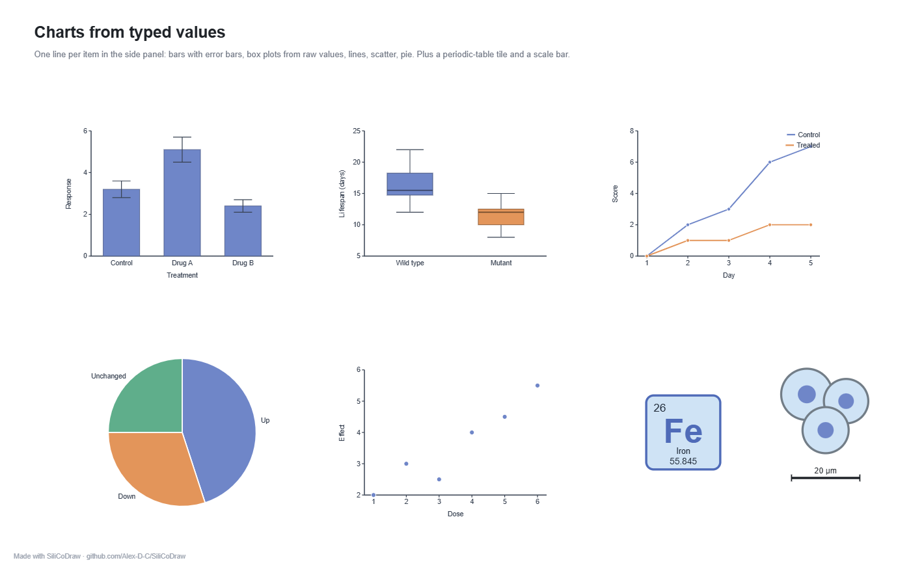
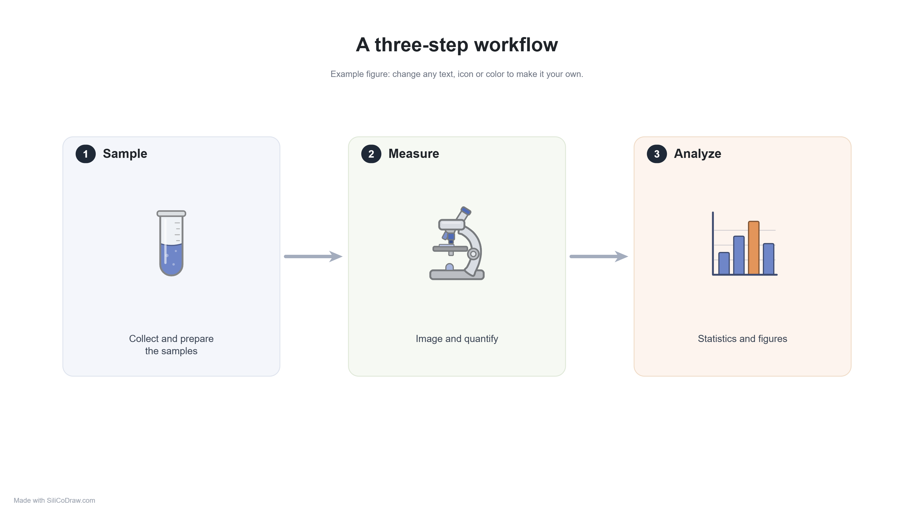
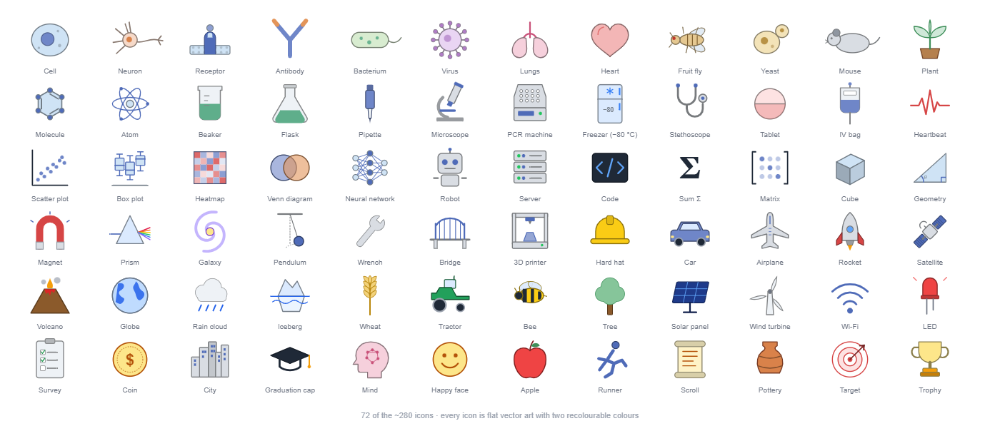

# SiliCoDraw

**Draw scientific figures in silico, together with your AI assistant.**

A small, local, open editor for scientific figures: poster figures, graphical abstracts, pathway
diagrams, workflow figures, timelines, teaching material. One HTML file plus a tiny server. Your
figures are plain JSON files in this folder, so an AI coding assistant can draw and revise them with
you, and you can drag things around by hand. Nothing leaves your computer.



## What you can make

<table>
<tr>
<td width="50%"><br><sub><b>Pathway figures</b> from the icon library and the new arrows: activation, inhibition ⊣, dashed feedback, elbow connectors, labels on arrows.</sub></td>
<td width="50%"><br><sub><b>Gantt charts</b> as one editable element: drag a bar sideways to shift it, up or down to change its row, drag its ends to resize; milestones stay attached.</sub></td>
</tr>
<tr>
<td><br><sub><b>Signalling at a membrane</b>: the ligand is drawn from its SMILES, the bilayer bends and stretches with draggable points, the receptor and cascade are library icons, the chart is typed values.</sub></td>
<td><br><sub><b>Immunology schematics</b>: immune-cell icons, antigen presentation, cytokine labels on arrows, an inhibition arrow for neutralisation, a legend.</sub></td>
</tr>
<tr>
<td><br><sub><b>Chemistry</b>: structures typed as SMILES and laid out automatically, a reaction scheme with a labelled arrow, a periodic-table tile.</sub></td>
<td><br><sub><b>Working mathematics</b>: typed functions are plotted, shapes report their angles and lengths while you drag their corners, formulas are typeset from LaTeX.</sub></td>
</tr>
<tr>
<td><br><sub><b>Charts from typed values</b>: bars with error bars, box plots from raw numbers, lines, scatter, pie; plus a periodic-table tile and a scale bar.</sub></td>
<td><br><sub><b>Workflow figures</b>: numbered panels, library icons and arrows, made from the built-in parts in a few minutes (`examples/workflow.json`).</sub></td>
</tr>
</table>



All of these are in `examples/` and open from **File ▾ → New figure → Example: …**, so you can take
them apart.

## Quick start

Get the folder: green **Code** button → *Download ZIP* and unzip it (or `git clone`). Nothing to
install: the editor is one HTML file plus a small server that needs only Python 3, and Windows works
even without Python.

| | Start it |
|---|---|
| **Windows** | double-click `Start SiliCoDraw.bat` (uses Python if you have it, otherwise the built-in PowerShell server) |
| **macOS** | run `sh start.sh` in Terminal the first time (it makes the double-click launchers executable and clears the download "quarantine" flag); after that, double-click `Start SiliCoDraw.command`. If macOS still says the file cannot be opened / "Apple could not verify" it (it is not from the App Store, so Gatekeeper blocks it once): System Settings → Privacy & Security → **Open Anyway**, or in Terminal `xattr -dr com.apple.quarantine <the SiliCoDraw folder>` |
| **Linux** | `sh start.sh` (or `python3 serve.py`) |

The editor opens at <http://localhost:8770/> in your browser. Keep the server window open while you
work; close it to stop. Works in any current browser (Chrome, Edge, Firefox, Safari); on a Mac the
shortcuts use ⌘ where this README says Ctrl. Touchscreens are supported (one finger moves, two
fingers zoom and pan, tap a text twice to edit it, press and hold for the menu).

## Keeping it up to date

Run the updater in the folder: `Update SiliCoDraw.bat` (Windows), `Update SiliCoDraw.command`
(macOS), `sh update.sh` (Linux / macOS) or `python3 update.py` anywhere. It downloads the current
version of this repository and replaces only the software files (editor, servers, launchers, docs,
examples). Your figures, `history/`, `exports/`, `assets/`, `archive/` and `trash/` are never touched and
nothing is deleted; replaced files are kept in `updates/backup-<date>/` for a while. `python3 update.py
--check` only lists what would change. If you cloned with git, `git pull` does the same. Restart the
server afterwards.

## Quickest start: hand the link to your AI

If you use an AI coding assistant that can run commands (Claude Code, Codex, Cursor or Copilot in
agent mode), paste this and you are done:

> Set up https://github.com/Alex-D-C/SiliCoDraw for me: clone it (or
> download and unzip the ZIP from the Code button), open the folder, read AGENTS.md, start the figure
> editor and open it in my browser.

Chat-only assistants cannot run anything on your computer; download the ZIP yourself and open the
folder in a coding assistant.

## Use it with an AI assistant

Open this folder in **Claude Code**, **Cursor**, **Codex**, **Copilot** or any assistant that reads
`AGENTS.md` / `CLAUDE.md`, and say, for example:

> Start the figure editor and build a graphical abstract of my paper: four steps, portrait format.

> Make a Gantt chart of my thesis plan: seven tasks from November to May, milestones at the end of
> each phase, a contingency strip underneath. Export it 16 cm wide at 300 dpi.

> Address the comments in `abstract.json`.

The assistant reads the figure files, edits them (the open editor updates live), replies on your
comments, and exports PNG/SVG/PPTX into `exports/`. `AGENTS.md` tells it everything about the file
format, every element type and the review loop.

## Features

**A library that covers most fields.** About 1200 flat, recolourable icons in 24 groups: cells &
tissues (organelles, cell types, bacteria, viruses, cell processes such as phagocytosis, endocytosis,
differentiation, migration, angiogenesis and metastasis, the cell cycle and spindle), molecules &
genetics (receptors, kinases, DNA replication, repair and transcription factors, CRISPR, RNAi,
vectors, small molecules), ageing & hallmarks (plus sarcopenia, osteoporosis, healthspan, senolytics,
reprogramming, parabiosis), immunology & infection (immune cells, antibodies, antigen presentation,
complement, pathogens from coronavirus to helminths, antibiotics and resistance), anatomy (organs and
their functional units: alveoli, nephron, villi, islets, blood–brain barrier, retina, cochlea…),
organisms (from nematode and killifish to naked mole-rat, bat, whale and Arabidopsis), chemistry
(benzene, amino acid, polymer, titration, distillation, electrolysis…), lab equipment, techniques &
assays (western blot, ELISA, qPCR, patch clamp, optogenetics, nanopore, single-cell droplets,
behavioural mazes, organ-on-a-chip, xenografts, cohorts and randomisation…), medicine & clinical
(imaging, vaccines, devices, risk factors), mind & behaviour, statistics & data (volcano, Manhattan,
UMAP, ROC, forest and epidemic curves), AI & computing (transformer attention, GPU, qubit, confusion
matrix…), mathematics, physics (particles, projectile, double slit, fission…), engineering &
materials (graphene, nanotube, lattice, gears, robot arm…), energy & electronics, transport &
aerospace, earth & climate (carbon and water cycles, hurricane, global warming…), ecology &
agriculture, society & economics (scientist, doctor, family, poster, peer review, open access…),
food, sport & nutrition, history & humanities, symbols. Every icon has a main and an accent colour you
can change. Search all 1850 items by name or keyword, jump to a group with the chips, collapse groups,
and the things you used recently stay at the top. Missing something? Ask your assistant to draw it;
an icon is ten lines of SVG and `AGENTS.md` explains the format.

**Elements that do work, not just pictures.**
- **Formulas**: a LaTeX element with a builder (Greek letters, operators, fractions, roots, matrices,
  ready-made equations, live preview), typeset into real vector paths that export cleanly.
- **Charts from your data**: type values in the side panel and get bars with error bars, box plots
  computed from raw numbers, lines, scatter or a pie.
- **Function plots**: `sin(x)`, `a*exp(-b*x)`, `1/x`… with parameters, auto-ranged axes and gaps at
  poles. **Geometry** whose angles, side lengths and area update as you drag the corners, a
  **vector** with live components, a **unit circle** with sin/cos/tan, a coordinate grid and a number
  line.
- **Gantt charts**: tasks, phases, milestones and dependencies as short lists; bars are dragged in
  time and across rows, resized at the ends, and milestones can be attached to a bar's start or end.
- **Bendable membranes and filaments**: a lipid bilayer drawn along a curve with draggable points.
  Drag an end to make it longer (lipids are added by themselves), drag a middle point to bend it, add
  points for more bends, or close the loop for a vesicle or a cell outline with a filled inside. The
  same element draws monolayers, bead filaments (actin-like) and tubes (microtubule-like).
- **Chemical structures**: a skeletal-formula editor. Type a SMILES string (`CCCC(=O)O`, `c1ccccc1`,
  caffeine, glucose…) and it is laid out: rings as regular polygons, fused rings, zigzag chains,
  substituents pointing outwards, heteroatoms labelled with their hydrogens, charges, double and
  triple bonds. Then build by hand: click an atom and blue dots show where a bond can go, click one
  to grow a carbon, type a letter to change the element (C N O S P F B I, L = Cl, R = Br), 1/2/3 for
  the bond order, W and D for wedge and hashed bonds, + and − for charges, Del to remove. Drag atoms
  to tidy (they snap to 30° and the bond length). Templates for common molecules are in the panel.
- A periodic-table tile, a microscopy scale bar, a funnel diagram, a Kaplan–Meier-style sketch, a QR
  code, legends, label chips.
- **Editable icons**: right-click an icon → *Convert to editable parts* turns it into plain shapes you
  can recolour, move, resize or delete. Select them and choose *Fuse & save as icon* when you are done:
  the result becomes one light element again and joins the Add panel as *bird2*, *bird3*… under
  **My icons** (the built-in icon is untouched; ✕ on an item removes it). Your icons are kept in
  `assets/my-icons.json`, which updates never touch, and are embedded in the figures that use them.

**Arrows for pathways.** Arrow, open, inhibitor ⊣, circle and diamond ends at either end, straight,
curved or elbow routing, solid, dashed or dotted, and an optional label on the line.

**Editing that stays out of the way.** Smart alignment guides and snapping, groups, align and
distribute, layers with lock and hide, right-click menu, in-place text editing, text boxes that
re-wrap when resized, a figure-wide colour palette with "replace a colour everywhere", templates,
resizable side panels, keyboard shortcuts (`?` shows them), unlimited undo, automatic version history,
archive and trash for finished or abandoned figures.

**Built for the review loop with an AI.** Pin a **comment** anywhere on the figure; the assistant
(or a colleague) replies on it. **Sketch mode**: draw a rough idea with a pen, add text notes, press
*Build it with my AI*, and paste the generated request into your assistant, which turns the sketch
into a real figure. A small page API (`window.fig`) lets the assistant read and change the figure
while you watch.

**Export for print and slides.** PNG at any physical width and dpi (tagged so Word and PowerPoint
place it at the right size), optionally transparent; SVG; and a PowerPoint slide in which text,
shapes, chips, arrows, funnels and legends stay native editable objects. **Several figures at once**:
tick them in a list with thumbnails and get one file each, or one PowerPoint deck with a slide per
figure.

## Working in the editor

- **Add** panel: type to search all items, or pick a group with the chips at the top; click a group
  title to collapse it; items you used recently stay at the top. Click or drag items onto the page.
  Drop or paste image files to insert them.
- Double-click text to edit it in place; double-click a formula for the builder. Right-click for the
  menu (it also has *Convert to editable parts* for icons and *Fuse into one element* for a
  selection). `?` shows all shortcuts.
- Text boxes: drag the side handles to set the width; the text re-wraps, the font size stays.
- `Ctrl+G` groups, `Ctrl+D` duplicates, `Ctrl+S` saves now (it also saves automatically),
  `Space`+drag pans, `Ctrl`+wheel / pinch zooms, `Shift+1` fits the page.
- Drag the edge of either side panel to make it wider or narrower (double-click the edge to reset).
- **File ▾**: new figure (from templates, the examples, or a copy), duplicate, rename, version
  history, archive (keeps the figure list short), trash (restorable; delete permanently from the trash).
- **Sketch mode** (pencil button, or File ▾ → New figure → "Sketch my idea first"): draw a rough idea
  with a pen and place text notes, then press **Build it with my AI**.
- **Export**: PNG with print width + dpi (optionally transparent), SVG, or a PowerPoint `.pptx`, all
  written to `exports/`. **File ▾ → Export several figures…** (or "Several figures…" in the Export
  dialog) exports a selection of figures in one go, or builds one PowerPoint with a slide per figure.
- New figures start with a small grey "Made with SiliCoDraw" line in the bottom-left corner. It is an
  ordinary text element: move it, edit it, or delete it.

## Managing figures: active, archived, trash

Every figure is one `.json` file. The editor sorts them into three places:

| Where | What it means | How to get there |
|---|---|---|
| **Active** (the folder itself) | figures you are working on; these appear in the figure switcher in the toolbar | **File ▾ → New figure**, or bring one back from the archive or trash |
| **Archived** (`archive/`) | finished figures you want to keep but not see every day | the **archive-box icon** next to the figure switcher: *Archive “…”* at the bottom moves the open figure there; clicking an archived figure opens it (it becomes active again) |
| **Trash** (`trash/`) | figures you no longer want; still restorable | the **trash icon**: *Move “…” to trash* at the bottom; each trashed figure has **Restore** and **✕** (delete permanently) |

Nothing is deleted directly: a figure first goes to the trash, and only **✕** in the trash (or *Empty
trash*) removes it for good, together with its version history, after a confirmation. Everything is a
plain file move, so you can also do it in your file manager while the editor is closed.

## Files

```
figure-editor.html   the editor
serve.py / serve.ps1 the server (same API; PowerShell one needs no Python on Windows)
update.py / update.ps1   the updater (see "Keeping it up to date")
Start SiliCoDraw.bat / .command, start.sh, Update SiliCoDraw.bat / .command, update.sh   launchers
figure.json, *.json  your figures (one file each)
examples/            example figures: signalling, immunology, chemistry, pathway, gantt, maths, data, icons, icon-library, workflow
docs/                the pictures in this README
history/             automatic snapshots      exports/   PNG, SVG, PPTX      assets/   inserted images + my-icons.json (your own icons)
```

## Privacy and network

The server listens on `localhost` only. `python3 serve.py --host 0.0.0.0` makes it reachable from
other devices on your network (e.g. a tablet) — there is no password, so do that only on a network
you trust. Writes (saving figures, exports, file operations) are accepted only from the editor itself and
from tools on your computer; a web page on another site cannot make your browser write into the figure
folder, because the server refuses cross-site requests.

## Status and contributing

Early but used daily by its author for real poster and thesis work; expect rough edges. It was built
together with an AI coding assistant, and that is also the intended way to extend it: open the folder
in your assistant and ask for the element or feature you need (`AGENTS.md` explains the structure).
Bug reports, new icons and example figures are welcome as issues or pull requests.

## Acknowledgements

All code, icons and example figures in this repository were written for it. Three permissively
licensed libraries are fetched from a CDN only at the moment you use the feature, and are not
bundled here: [qrcode-generator](https://github.com/kazuhikoarase/qrcode-generator) (MIT, Kazuhiko
Arase) for QR codes, [PptxGenJS](https://github.com/gitbrent/PptxGenJS) (MIT, Brent Ely) for the
PowerPoint export, and [MathJax](https://www.mathjax.org/) (Apache 2.0) to typeset formulas. A
typeset formula is stored as paths in your figure, so it keeps working offline afterwards.

## License

MIT — see `LICENSE`.
