<h1><picture><source media="(prefers-color-scheme: dark)" srcset="brand/lockup-dark.svg">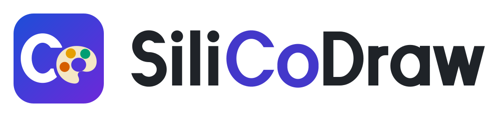</picture></h1>

**Draw scientific figures in silico, together with your AI assistant.**

A small, local, open editor for scientific figures: poster figures, graphical abstracts, pathway
diagrams, workflow figures, timelines, teaching material. One HTML file plus a tiny server. Your
figures are plain JSON files in this folder, so an AI coding assistant can draw and revise them with
you, and you can drag things around by hand. Nothing leaves your computer.

About 1,600 icons are built in, and about 10,700 more come from 15 open libraries (Servier Medical Art,
PhyloPic, NIH BioArt Source, Reactome, Health Icons, Bioicons, SciDraw and others) that you import with
one click; for those that ask to be credited, SiliCoDraw writes the credit line on the page.

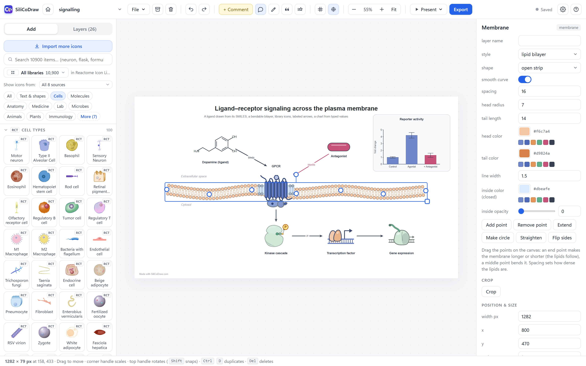

## What you can make

<table>
<tr>
<td width="50%">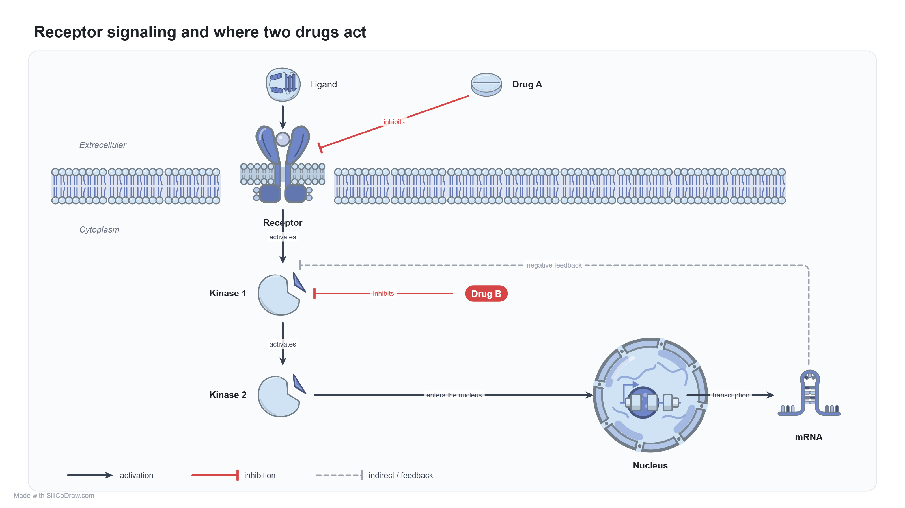<br><sub><b>Pathway figures</b> from the icon library and the new arrows: activation, inhibition ⊣, dashed feedback, elbow connectors, labels on arrows.</sub></td>
<td width="50%">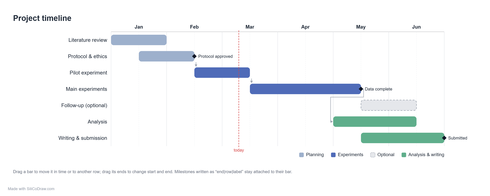<br><sub><b>Gantt charts</b> as one editable element: drag a bar sideways to shift it, up or down to change its row, drag its ends to resize; milestones stay attached.</sub></td>
</tr>
<tr>
<td>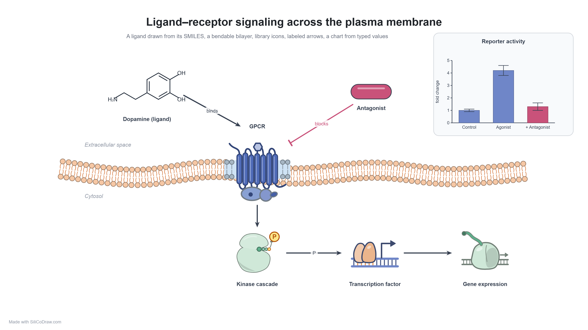<br><sub><b>Signaling at a membrane</b>: the ligand is drawn from its SMILES, the bilayer bends and stretches with draggable points, the receptor and cascade are library icons, the chart is typed values.</sub></td>
<td>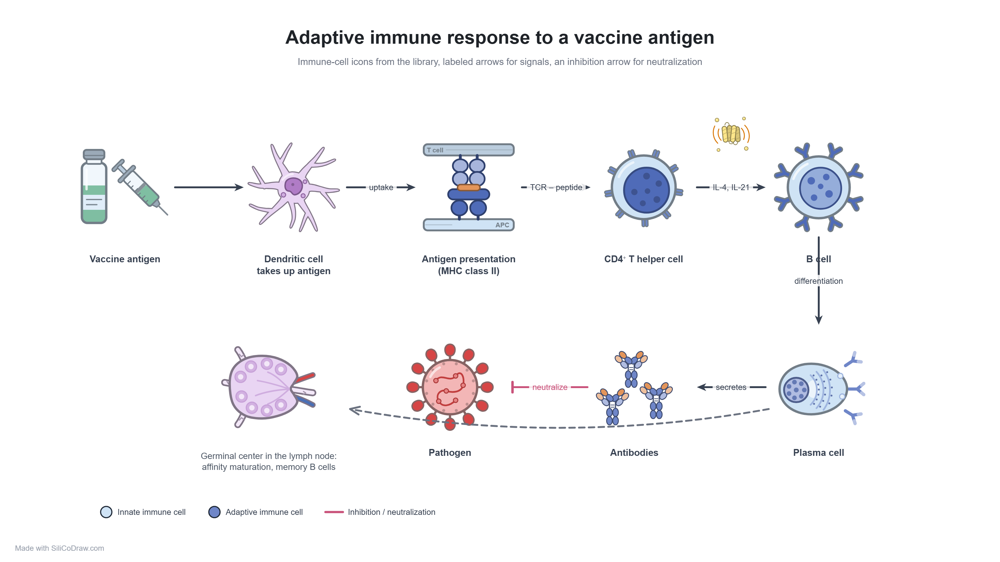<br><sub><b>Immunology schematics</b>: immune-cell icons, antigen presentation, cytokine labels on arrows, an inhibition arrow for neutralization, a legend.</sub></td>
</tr>
<tr>
<td>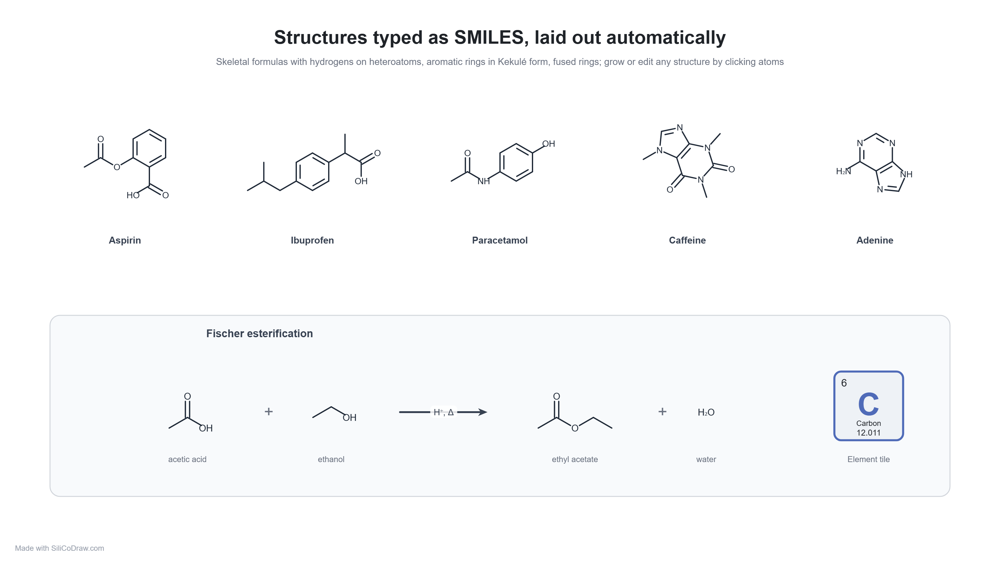<br><sub><b>Chemistry</b>: structures typed as SMILES and laid out automatically, a reaction scheme with a labeled arrow, a periodic-table tile.</sub></td>
<td>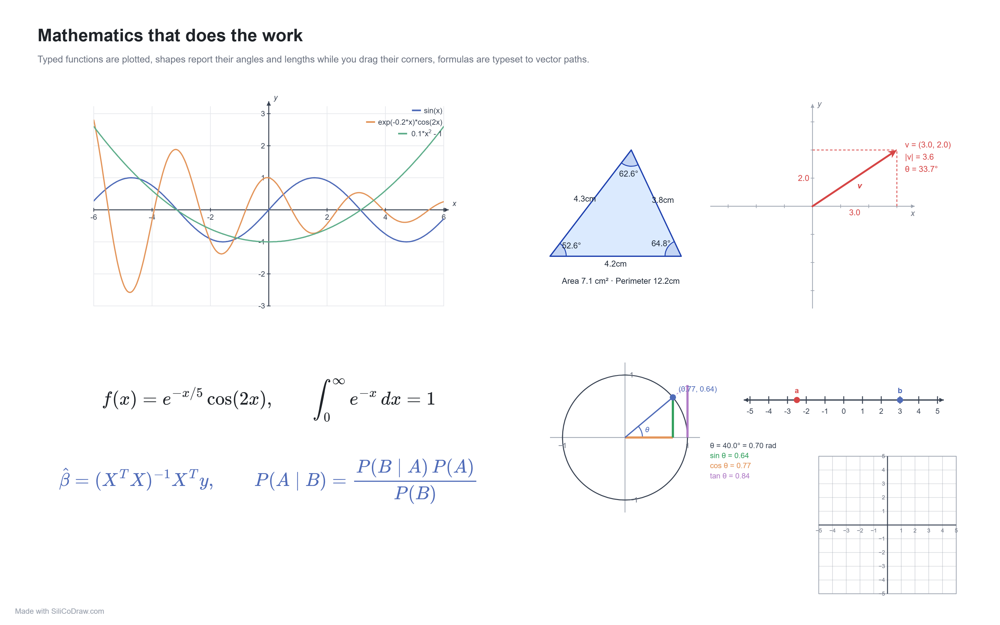<br><sub><b>Working mathematics</b>: typed functions are plotted, shapes report their angles and lengths while you drag their corners, formulas are typeset from LaTeX.</sub></td>
</tr>
<tr>
<td>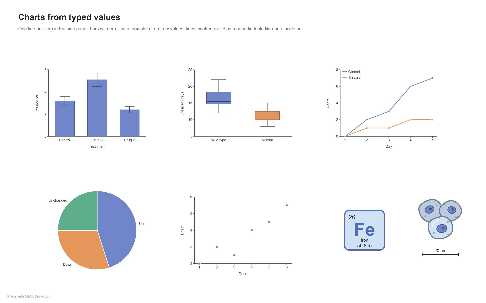<br><sub><b>Charts from typed values</b>: bars with error bars, box plots from raw numbers, lines, scatter, pie; plus a periodic-table tile and a scale bar.</sub></td>
<td>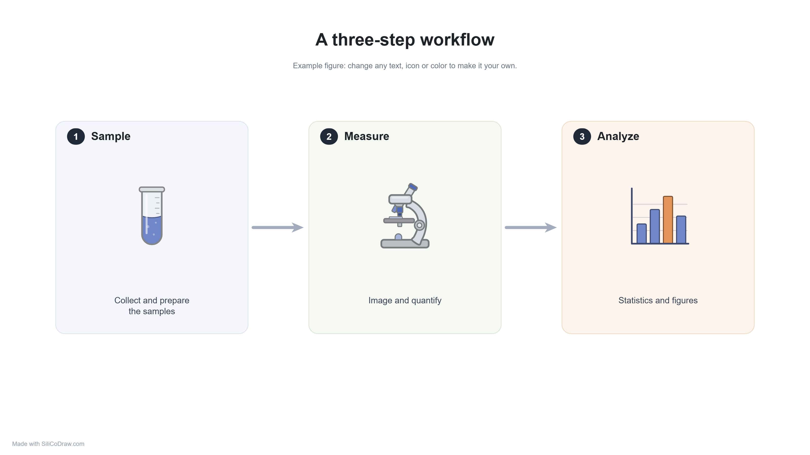<br><sub><b>Workflow figures</b>: numbered panels, library icons and arrows, made from the built-in parts in a few minutes (`examples/workflow.json`).</sub></td>
</tr>
<tr>
<td>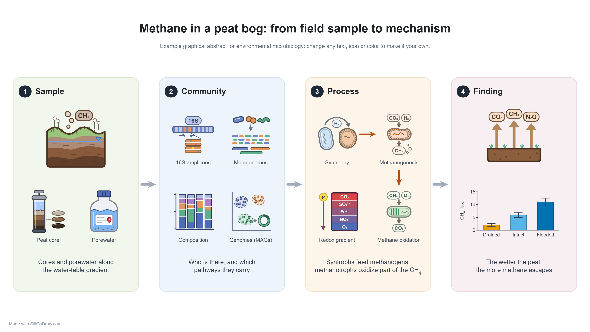<br><sub><b>Graphical abstracts for environmental microbiology</b>: habitats, microbes, element cycles and field methods from the icon library, with a chart from typed values (`examples/environmental-microbiology.json`).</sub></td>
<td>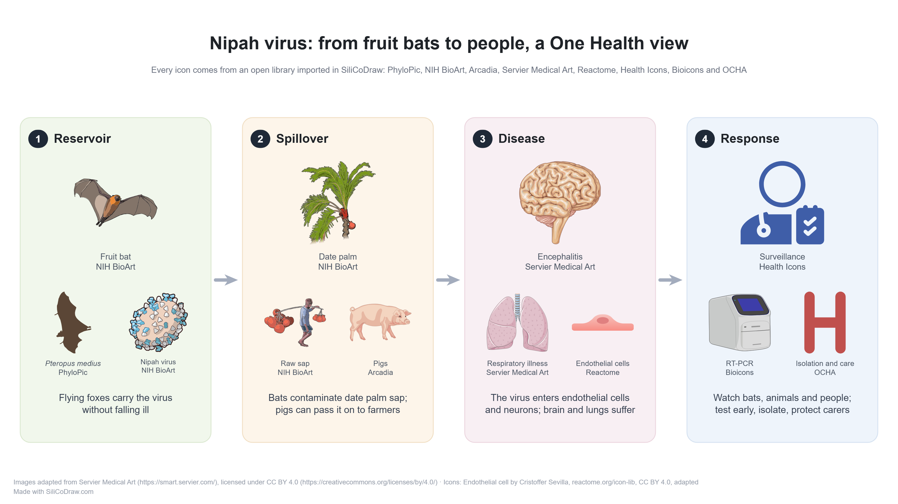<br><sub><b>Icons from eight open libraries in one figure</b>: PhyloPic, NIH BioArt, Arcadia, Servier Medical Art, Reactome, Health Icons, Bioicons and OCHA, with the credit line SiliCoDraw wrote at the bottom (`examples/one-health.json`).</sub></td>
</tr>
</table>

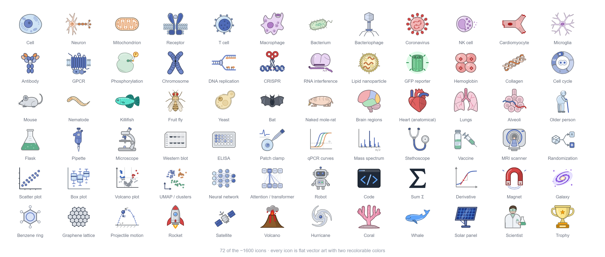

All of these are in `examples/` and open from **File ▾ → New figure → Example: …**, so you can take
them apart.

## Install and start

SiliCoDraw runs on your own computer and opens in your web browser. It is free, and it does not need
an account.

**Official downloads come only from [github.com/Alex-D-C/SiliCoDraw](https://github.com/Alex-D-C/SiliCoDraw). I never send
executables by email or chat; do not run one that claims to be SiliCoDraw.** See [SECURITY.md](SECURITY.md).

### Mac

**The easy way: one line in Terminal (about one minute).**

1. Open **Terminal**: press **⌘ Command + Space**, type `Terminal` and press **Return**.
2. Copy this line, paste it into the Terminal window (**⌘ V**) and press **Return**:

   ```bash
   curl -fsSL https://raw.githubusercontent.com/Alex-D-C/SiliCoDraw/main/install.sh | sh
   ```

3. SiliCoDraw is downloaded into a folder called **SiliCoDraw** in your home folder, and the editor
   opens in your browser. That folder is also where your figures are saved.
4. Leave the Terminal window open while you work (you can minimize it). To quit SiliCoDraw, choose
   **File ▾ → Quit SiliCoDraw** in the editor, or close the Terminal window (if macOS asks whether to
   terminate the running process, click **Terminate**).

**Next time**, start it like any app: press **⌘ Command + Space**, type `SiliCoDraw` and press
**Return**. You can also double-click **Start SiliCoDraw.command** in the SiliCoDraw folder.

**If Terminal says that SiliCoDraw needs Python 3**, a window also asks to install the "command line
developer tools". Click **Install**, wait until it says the software was installed (5 to 20 minutes),
then paste the same line into Terminal again. If no such window appears, install Python 3 from
[python.org/downloads](https://www.python.org/downloads/) and paste the line again.

**If a window asks whether Terminal may access a folder**, click **Allow**.

<details>
<summary><b>Plan B for a Mac: download the ZIP instead</b></summary>

1. On this page, click the green **Code** button, then **Download ZIP**. Safari unzips it into a folder
   called **SiliCoDraw-main** in your Downloads folder (otherwise double-click the ZIP file).
2. Open **Terminal** (**⌘ Command + Space**, type `Terminal`, press **Return**).
3. Type `sh` followed by a space. Do not press Return yet.
4. Drag the file **start.sh** from the SiliCoDraw-main folder into the Terminal window, then press
   **Return**. If macOS asks whether Terminal may access your Downloads folder, click **Allow**.
5. SiliCoDraw offers to move its folder out of Downloads into your home folder, where it is safe from
   clean-ups. Press **Return** to accept.

After that, start it with **⌘ Command + Space**, `SiliCoDraw`, **Return**, as above.

Why not just double-click a file in the ZIP? macOS blocks programs from the internet that are not from
the App Store, with a message such as *"Apple could not verify…"* or *"could not be executed because you
do not have appropriate access privileges"*. Starting SiliCoDraw once from Terminal as above removes
that block for this folder. If you already double-clicked and saw such a message, click **Done** or
**OK** (not *Move to Trash*) and continue with step 2.
</details>

### Windows

1. On this page, click the green **Code** button, then **Download ZIP**.
2. Open your Downloads folder, right-click the ZIP file and choose **Extract All…**, then **Extract**.
   SiliCoDraw does not run from inside the ZIP file. You can move the extracted folder to Documents.
3. Open the extracted folder (if it only contains another **SiliCoDraw-main** folder, open that one too)
   and double-click **Start SiliCoDraw.bat**.
4. If Windows shows *"Windows protected your PC"*, click **More info**, then **Run anyway**. Windows
   shows this once for files downloaded from the internet.
5. The editor opens as a tab in your browser as soon as SiliCoDraw is ready. Its server runs in a minimized
   window, **SiliCoDraw server** in the taskbar; leave it running while you work. To quit SiliCoDraw, choose
   **File ▾ → Quit SiliCoDraw** in the editor (it saves first), or close that window.

Python is not needed on Windows: the start file uses Python if it is installed and Windows' own
PowerShell otherwise.

**A Start-menu shortcut with the SiliCoDraw icon:** double-click **Add SiliCoDraw to the Start menu.bat** in the
SiliCoDraw folder (only for you, no administrator rights needed). It asks once whether you also want one on the
Desktop. After that, press the Windows key, type `SiliCoDraw` and press Enter. Double-click the same file again to
update the shortcut or to remove it. If you move the SiliCoDraw folder, start it once from its new place with
**Start SiliCoDraw.bat**: the shortcut then follows it.

If your workplace PC does not let SiliCoDraw start (IT policy), the start file says so: use
[silicodraw.com](https://silicodraw.com) in the browser instead (once opened there, the editor also works offline).

### Linux

The Mac line works on Linux too, or download the folder and run `sh start.sh`. It needs Python 3.7 or
newer (`sudo apt install python3` on Ubuntu). On a desktop, `start.sh` also adds **SiliCoDraw** with its icon
to your applications menu (`~/.local/share/applications/SiliCoDraw.desktop`). File ▾ → Quit SiliCoDraw stops it.

### Good to know

The editor lives at <http://localhost:8770/> while SiliCoDraw runs; bookmark it if you like. That address
opens where you left off: the figure you were working on, or **Home**, the page of all your figures, if that
was showing (see [Managing figures](#managing-figures-active-archived-trash));
`http://localhost:8770/?file=<name>.json` opens one figure directly. It works
in any current browser (Chrome, Edge, Firefox, Safari). On a Mac the shortcuts use ⌘ where this
README says Ctrl and ⌥ Option where it says Alt (Redo is ⌘⇧Z or ⌘Y). Tablets work too: one finger moves, two fingers zoom and pan, tap a text twice
to edit it, press and hold for the menu.

Phones get a layout of their own (in windows under 700 px wide, and on a phone held sideways): the
canvas fills the screen, a toolbar at the bottom holds Add, Layers, Select several, Sketch and Page
(with something selected: Edit, Style, Duplicate, Arrange, Lock, Delete), and the panels open as
sheets. A tap selects, a drag on a selected element moves it, a drag anywhere else pans (a flick goes
on for a moment), two fingers zoom, press and hold for the menu; a stylus works as a finger does, and
draws in Sketch. At a phone's opening zoom a small element simply moves when dragged (zoom in for its
ends and points). Export makes a PNG and **Share…** sends it to Photos, Files or a message; several
figures go into one .zip. A link opened inside an app (LinkedIn, Facebook…) lands in that app's built-in
browser, where exports may not save and figures may not last: the editor says so, and the page is better
opened in Safari or Chrome. **⋯ → Help** lists the gestures; **Appearance → Phone layout** turns it on or off (Off still keeps it
under 560 px wide, where the side panels would leave no canvas; `?phone=1` / `?phone=0` in the address
force it for one visit).

<details>
<summary><b>Something did not work?</b></summary>

| What you see | What to do |
|---|---|
| The page says **Server offline** | The Terminal window (Mac) or the **SiliCoDraw server** window (Windows) was closed. Start SiliCoDraw again; your work was saved. |
| The page says **SiliCoDraw has stopped** | Someone chose File ▾ → Quit SiliCoDraw (in this tab or another one). Close the tab. Starting SiliCoDraw again opens the editor in a new tab. |
| Windows: *"Your IT policy blocks the local SiliCoDraw server"* | The PC only runs approved programs and scripts. Use [silicodraw.com](https://silicodraw.com) instead (in Chrome or Edge it can keep your figures in a folder). |
| Mac: *"Apple could not verify…"*, *"cannot be opened"* or *"could not be executed because you do not have appropriate access privileges"* | Click **Done** or **OK**, then use Plan B above (steps 2 to 4). |
| Mac: *"Operation not permitted"* | Click **Allow** when macOS asks about folder access, or move the SiliCoDraw folder into your home folder and start it again. |
| Mac: Command + Space does not find SiliCoDraw | Start it once with the Terminal line or Plan B; that creates the app. Spotlight can take a minute to find a new app. |
| Mac: *SiliCoDraw cannot find its folder* | The folder was moved or renamed. Start it once from its new place with Plan B steps 2 to 4; that repairs the app. |
| Windows: *"cannot run from inside the ZIP file"* | Extract the ZIP first (step 2), then start SiliCoDraw from the extracted folder. |
| *"Could not start on port 8770"* | Another program uses that port. Restart the computer and start SiliCoDraw again. Or use another port. On a Mac, run `sh ~/SiliCoDraw/start.sh --port 8771` in Terminal. On Windows, open the SiliCoDraw folder, type `powershell -ExecutionPolicy Bypass -File serve.ps1 -port 8771` in the address bar of the folder window and press Enter. Then open <http://localhost:8771/>. |

Still stuck? Open an issue on the [issues page](https://github.com/Alex-D-C/SiliCoDraw/issues) and
say what you did and what you saw.
</details>

## Keeping it up to date

**Please read first: the updater is new and has not been tested by its author yet.** Before you
update, save your work, close SiliCoDraw, and copy your figures (the `.json` files in the SiliCoDraw
folder, and the `assets` folder) to a separate place, such as another folder or a USB stick. After
updating, please report how it went on the [issues page](https://github.com/Alex-D-C/SiliCoDraw/issues),
whether it worked or not. The updater prints a link that fills in the report for you; it contains no
personal information, and you need a free GitHub account to send it.

To update, open the SiliCoDraw folder and:

- **Mac**: double-click **Update SiliCoDraw.command** (a Terminal window opens).
- **Windows**: double-click **Update SiliCoDraw.bat**.
- **Linux**: run `sh update.sh`.

The updater shows the notice above and changes nothing until you type **Y** and press Return. Then it:

1. downloads the newest version and checks that the download is complete,
2. saves a copy of your figures in `updates/figures-backup-<date>.zip`,
3. replaces only the software files (the editor, servers, launchers, docs and examples), keeping the
   previous version of each in `updates/backup-<date>/` (the newest 5 are kept),
4. puts every file back as it was if anything goes wrong in the middle.

Your figures, `history/`, `exports/`, `assets/`, `archive/` and `trash/` are never touched. Start
SiliCoDraw again afterwards and reload the browser page. If you cloned the folder with git, use
`git pull` instead.

## Quickest start: hand the link to your AI

If you use an AI coding assistant that can run commands (Claude Code, Codex, Cursor or Copilot in
agent mode), paste this and you are done:

> Set up https://github.com/Alex-D-C/SiliCoDraw for me: clone it (or
> download and unzip the ZIP from the Code button), open the folder, read AGENTS.md, start the figure
> editor and open it in my browser.

Chat-only assistants cannot run anything on your computer; download the ZIP yourself and open the
folder in a coding assistant.

## Use it with an AI assistant

Open this folder in **Claude Code**, **Cursor**, **Codex**, **Copilot** or any assistant that reads
`AGENTS.md` / `CLAUDE.md`, and say, for example:

> Start the figure editor and build a graphical abstract of my paper: four steps, portrait format.

> Make a Gantt chart of my thesis plan: seven tasks from November to May, milestones at the end of
> each phase, a contingency strip underneath. Export it 16 cm wide at 300 dpi.

> Address the comments in `abstract.json`.

The assistant reads the figure files, edits them (the open editor updates live; when you are editing at
the same moment, its changes and yours are merged element by element; what it added or changed is
outlined for a moment, and one Ctrl+Z takes it back), replies on your comments, and exports
PNG/PDF/TIFF/SVG/PPTX into `exports/`. Figure files are written one element per line, so the assistant
can read and edit one element at a time; if it ever writes a broken file, the status line says
"File has an error" and the canvas keeps the last good version. `AGENTS.md` tells it everything about the file
format, every element type and the review loop.

## Features

**A library that covers most fields.** About 1,600 flat, recolorable built-in icons in 25 groups (and many more to import, below): cells &
tissues (organelles, cell types, bacteria, viruses, cell processes such as phagocytosis, endocytosis,
differentiation, migration, angiogenesis and metastasis, the cell cycle and spindle), molecules &
genetics (receptors, kinases, DNA replication, repair and transcription factors, CRISPR, RNAi,
vectors, small molecules), aging & hallmarks (plus sarcopenia, osteoporosis, healthspan, senolytics,
reprogramming, parabiosis), immunology & infection (immune cells, antibodies, antigen presentation,
complement, pathogens from coronavirus to helminths, antibiotics and resistance), anatomy (organs and
their functional units: alveoli, nephron, villi, islets, blood–brain barrier, retina, cochlea…),
organisms (from nematode and killifish to naked mole-rat, bat, whale and Arabidopsis), chemistry
(benzene, amino acid, polymer, titration, distillation, electrolysis…), lab equipment, techniques &
assays (western blot, ELISA, qPCR, patch clamp, optogenetics, nanopore, single-cell droplets,
behavioral mazes, organ-on-a-chip, xenografts, cohorts and randomization…), medicine & clinical
(imaging, vaccines, devices, risk factors), mind & behavior, statistics & data (volcano, Manhattan,
UMAP, ROC, forest and epidemic curves), AI & computing (transformer attention, GPU, qubit, confusion
matrix…), mathematics, physics (particles, projectile, double slit, fission…), engineering &
materials (graphene, nanotube, lattice, gears, robot arm…), energy & electronics, transport &
aerospace, earth & climate (carbon and water cycles, hurricane, global warming…), ecology &
agriculture, environmental microbiology (microbes and their communities, habitats from soil profile to
hot spring, the nitrogen, sulfur, phosphorus and iron cycles, wastewater treatment, corers, filters,
microcosms, 16S amplicons and metagenomes), society & economics (scientist, doctor, family, poster, peer review, open access…),
food, sport & nutrition, history & humanities, symbols. Every icon has a main and an accent color you
can change. Search all items (about 1,700 built in, over 12,000 with every library imported) by name or keyword (British or American spelling, plurals, common
synonyms and abbreviations such as *cardiac* or *ab*, and small typos all find it), jump to a group with the
chips, collapse groups, star favorites, and the things you used recently stay at the top. Missing something? Ask your assistant to draw it;
an icon is ten lines of SVG and `AGENTS.md` explains the format.

**Elements that do work, not just pictures.**
- **Rich text anywhere**: select part of a text and press the bar (or Ctrl+B / I / U) for **bold**,
  *italic*, underline, strikethrough, superscript and subscript (`x^2`, `Ca^{2+}`, `H_2O`, `CO_{2}`; letters need braces: `x^{n}`) or a
  colored run (`{#d64545|text}`). The same marks work in chips, arrow labels and legends, lone
  significance stars and sample names such as `rep_1` are left alone (type `\*` for a literal star), species names are italicized
  automatically, and every run survives the PowerPoint export as real formatting. With texts selected on the canvas (not typing),
  Ctrl+B / Ctrl+I make the whole texts bold or italic.
- **Symbols and typography**: the **Ω** button on the formatting bar (and beside label fields) types µ, Greek letters, ±, °, ≤,
  arrows and more; or type a LaTeX name and a space (`\alpha `, `\mu `, `\pm `, `\deg `). Icon, chip and arrow labels take a
  second line (Enter in the field), icon labels have their own color, texts and section boxes a line spacing, and the font list
  includes Verdana and Courier (monospace, for sequences). Long gene lists, links and DOIs wrap inside their box.
- **Find and replace** (Ctrl+F, or right-click empty canvas): renames "Drug A" to "Rapamycin" in every text, chip, label,
  chart, legend and Gantt list at once, on every slide of a presentation (match case, whole word), selects every element that
  has a word, and undoes in one step.
- **Formulas**: a LaTeX element with a builder (Greek letters, operators, fractions, roots, matrices,
  ready-made equations, live preview), typeset into real vector paths that export cleanly.
- **Charts from your data**: type values in the side panel and get bars with error bars, box plots
  computed from raw numbers, lines, scatter or a pie.
- **Function plots**: `sin(x)`, `a*exp(-b*x)`, `1/x`… with parameters, auto-ranged axes and gaps at
  poles. **Geometry** whose angles, side lengths and area update as you drag the corners, a
  **vector** with live components, a **unit circle** with sin/cos/tan, a coordinate grid and a number
  line.
- **Network medicine diagrams**: disease modules inside an interaction network, STRING-style.
  Choose how many modules, how many dots each has (with optional gene names), how many dots are not
  associated, how many are shared between modules, and how likely links are inside versus between
  modules; add drugs linked to their targets, with sliders for the number of targets, how spread out they are, and how close they lie to each module (the panel and the statistics show the resulting average distances). Drag single dots (Shift + drag moves a whole module) and
  the links and module areas follow; click two dots to add or remove the link between them. *Scatter randomly* spreads all dots at random so the modules are no longer clustered (the links stay), and *Gather into modules* brings them back, both as a short animation. Show or
  hide links, module areas (a smooth outline or a shape that hugs the dots), names, a legend, and
  module statistics including the network separation s(A,B). Presets are under *Diagrams* in the Add
  panel.
- **Gantt charts**: tasks, phases, milestones and dependencies as short lists; bars are dragged in
  time and across rows, resized at the ends, and milestones can be attached to a bar's start or end.
- **Bendable membranes and filaments**: a lipid bilayer drawn along a curve with draggable points.
  Drag an end to make it longer (lipids are added by themselves), drag a middle point to bend it, add
  points for more bends, or close the loop for a vesicle or a cell outline with a filled inside. The
  same element draws monolayers, bead filaments (actin-like) and tubes (microtubule-like).
- **Chemical structures**: a skeletal-formula editor. Type a SMILES string (`CCCC(=O)O`, `c1ccccc1`,
  caffeine, glucose…) and it is laid out: rings as regular polygons, fused rings, zigzag chains,
  substituents pointing outwards, heteroatoms labeled with their hydrogens, charges, double and
  triple bonds. Then build by hand: click an atom and blue dots show where a bond can go, click one
  to grow a carbon, type a letter to change the element (C N O S P F B I, L = Cl, R = Br), 1/2/3 for
  the bond order, W and D for wedge and hashed bonds, + and − for charges, Del to remove. Drag atoms
  to tidy (they snap to 30° and the bond length). Templates for common molecules are in the panel.
- A periodic-table tile, a microscopy scale bar, a funnel diagram, a Kaplan–Meier-style sketch, a QR
  code, legends, label chips.
- **Editable icons**: right-click an icon → *Convert to editable parts* turns it into plain shapes you
  can recolor, move, resize or delete. Select them and choose *Save as icon…* when you are done:
  you name it, the parts become one light element again, and it joins the Add panel under
  **My icons** (the built-in icon is untouched; ✕ on an item removes it). The same works for a
  **group of icons**: select several (or group them with Ctrl+G or the *Group* button in the side
  panel) and choose *Save as icon…*; the elements stay in the figure as they are. Your icons are kept in
  `assets/my-icons.json`, which updates never touch, and are embedded in the figures that use them. An own icon
  named like an icon the library gets later keeps its drawing (it moves to `lake2` beside the built-in `lake`).
- **More icons from open libraries**: *Import more icons* at the top of the Add panel lists 15 icon packs, about
  10,700 icons converted from open repositories: Servier Medical Art (3,193 shaded medical drawings), PhyloPic (3,178
  organism silhouettes), NIH BioArt Source (752), Reactome (645), Health Icons (640), Bioicons (454), SciDraw (367),
  WMO weather symbols (355), OCHA humanitarian icons (283), Open Crop Icons (221), electric circuit symbols (204),
  BioDraws (160), Arcadia Science's organisms (144), SBOL Visual glyphs for genetic designs (63) and Expression Atlas
  anatomograms (28). Their licenses and how each wants to be credited are in
  [Third-party icon packs](#third-party-icon-packs). The list has a search (name, subject, license) and chips by field
  (biology, medicine, ecology, earth, engineering, imported). A pack opens with its license and how its makers ask to be
  credited; you tick a box and import it. A **library switcher** under the search then shows every library at once or
  one of them (SiliCoDraw's own icons, My icons, or a pack). With all libraries shown, the chips are shared categories
  (Cells, Molecules, Anatomy, Medicine, Lab, Microbes, Animals, Plants, Immunology…) that gather the matching groups
  of every library, so a yeast is under Microbes whichever library drew it; inside one library they are its own groups.
  Search ranks the icons of every library together, with the ten best in a *Most relevant* block (a built-in icon that
  matches as well as a pack's comes first; a closer name still wins), and *Show icons from* hides the libraries you do
  not want listed. Pack icons carry a small mark and a tooltip with source, creator and license, and are recolorable by
  **Colors in this icon** (one swatch per group of similar colors, largest first; a new color keeps the shading, *One
  color* tints the whole drawing; a drawing its library had in several colors is one icon whose other colors are
  **colorways**, one click each). A figure carries the drawings it uses, so it opens anywhere, also where the pack
  was never imported. Where a license asks for attribution, SiliCoDraw adds a small
  **credit line** to the page when you place such an icon and keeps it up to date (move, edit or delete it; the
  Export dialog reminds you if it is gone, on any slide). With more than three icons that are credited one by one the
  line names only the repository: Page → *Copy full icon credits* gives every creator, DOI and license link as text
  for the legend or the acknowledgments.
  Crediting correctly stays your responsibility, and CC BY-SA can extend to the figure you build: check your
  journal's terms. See "Third-party icon packs" below.

**Arrows for pathways.** Arrow, open, inhibitor ⊣, circle and diamond ends at either end, straight,
curved or elbow routing (the automatic elbow bends up to twice, for side-to-side steps and loops back),
solid, dashed or dotted, and a label you can slide along the line, on a backdrop in the page color.
*Reverse direction* (side panel or right-click) turns an arrow round without moving it.
**Connectors**: drag an arrow end onto an element (or select elements and choose *Connect*: a chain,
one to many, or many into one) and the arrow stays attached: it follows when the element is moved,
turned, resized or aligned, elbows re-route, several arrows on one side spread out, and the
PowerPoint export keeps them as connectors glued to the shapes.

**Colors everyone can read.** About 1 in 12 men cannot tell red from green, and many journals ask
for colorblind-safe figures. Page panel → **Preview colors as** shows the canvas as seen with
deuteranopia, protanopia or tritanopia, or in grayscale (only on your screen: never saved or
exported). **Edit palette…** has colorblind-safe presets (Okabe–Ito, Paul Tol's bright, muted and
high-contrast sets, viridis, cividis, grayscale) with a preview of each set per vision type and the
closest pair named; it can recolor the whole figure in one step (undo takes it back) and give chart
series, survival lines and network modules these colors. **Check colors** (and the Export dialog)
lists text with too little contrast against what it sits on and chart colors that look alike for
colorblind readers. On a dark page, charts draw their labels and axes in light gray by themselves.

**Editing that stays out of the way.** Smart alignment guides and snapping, groups, align and
distribute, layers with lock and hide, right-click menu, in-place text editing, text boxes that
re-wrap when resized, a figure-wide color palette (its swatches under every color field) with "replace a color everywhere", templates,
resizable side panels, keyboard shortcuts (`?` shows them), undo of the last 300 steps, automatic version history,
archive and trash for finished or abandoned figures. A light and a dark theme, four interface styles
and three panel layouts let you make the editor your own.
**Keyboard and screen readers**: F6 moves between the toolbar, the panels and the canvas; on the canvas
Tab selects the next element and the arrow keys move it; screen readers hear what is selected, toggle
states and messages; the toolbar wraps onto a second row at high browser zoom; the High contrast style is
picked automatically when the system asks for more contrast, and Windows contrast themes leave the figure's
own colors alone.

**Built for the review loop with an AI.** Pin a **comment** on any element (it moves with that
element); the assistant (or a colleague) replies on it, and the Comments list shows when you edited a
comment after the reply. **Sketch mode**: draw a rough idea with a pen, add text notes, press
*Build it with my AI*, and paste the generated request into your assistant, which turns the sketch
into a real figure. A small page API (`window.fig`) lets the assistant read and change the figure
while you watch.

**Export for journals, print and slides.** A vector **PDF** whose text stays text (set in Helvetica,
Times or Courier, the fonts every PDF reader has, at the widths it has on the canvas; Greek letters and
math signs included; the fonts are not embedded, so for a submission system that requires embedded fonts
tick "rasterize"), with icons, formulas and charts as vector paths and inserted pictures at their own
resolution; a **TIFF** (LZW-compressed or uncompressed, with its dpi) for journals that ask for one;
PNG at any physical width and dpi (tagged so Word and PowerPoint place it at the right size); all
optionally transparent; SVG; and a PowerPoint slide in which text, shapes, chips, arrows, funnels and
legends stay native editable objects (Google Slides opens the same file, equally editable). **Journal
sizes**: pick Nature, Cell Press, Science, PNAS, PLOS or eLife column widths (or an A0/A1 poster) and
the dialog sets the print width and a suitable resolution (600 dpi for line art, 300 with photos) and
checks the smallest text, the thinnest line and the pictures' print resolution (ppi) at that size.
**Text sizes**: set the print size once in the Page panel and every font size field shows its printed
pt; *Text sizes…* lists all sizes in the figure and raises everything below, say, 6 pt in one step.
**Posters**: File ▾ → New figure has A0 portrait (3 columns) and A0 landscape (4 columns) posters with
the print size already set (title band with authors and affiliations, logo spots, section boxes,
take-home message, references, a contact QR code), plus graphical abstracts in the common shapes
(landscape 2.5 : 1 as Elsevier asks, square as Cell Press, a 3.25 × 1.75 in table-of-contents graphic
as ACS; check your journal's guide). The print size list also has US poster boards (36 × 48, 48 × 36,
44 × 44, 72 × 36 in). When the page has another shape than the poster sheet, the Page panel says how
much of the sheet would stay empty and *Give the page the sheet's shape* fixes it (the Export dialog has the same button for a sheet picked there). With a poster print
size the PowerPoint slide is the printed size, so its font sizes are the printed ones, and new elements
start large enough to read (body text about 28 pt). A **Section box** (Add panel) holds its own
wrapped text with an optional header: widen it with its side handles and the text re-wraps, type more and it grows downward.
**Several figures at once**: tick them in
a list with thumbnails and get one file each, one PDF with a page per figure, or one PowerPoint deck
with a slide per figure.

## Working in the editor

- **Add** panel: type to search all items, or pick a group with the chips at the top (with icon packs imported:
  a library with the switcher under the search, and a category with the chips); click a group title to collapse it; items you used recently and favorites (☆ on an item, or F) stay at the top. Click
  or drag items onto the page, or press ↓ in the search field, walk the results with the arrow keys and
  press Enter (Shift+Enter also moves to the new element's fields).
  Drop or paste image files to insert them. A picture is never stretched: width and height set a frame
  it fills (*Fill the frame*), "part shown" picks what is visible; *Stretch* shows the whole picture at its own
  proportions. TIFF files (from a microscope, or the editor's own TIFF export) are stored as PNG, so they
  show in every browser, PowerPoint and PDF: uncompressed, LZW, PackBits or Deflate, 8/16/32-bit gray, RGB
  or RGBA, the first page of a stack; 16- and 32-bit pictures get their brightness stretched from the
  darkest to the brightest value, as ImageJ shows them. An iPhone HEIC photo is stored as JPEG where the
  browser can open it (Safari); in Chrome or Firefox export it as JPEG first (Photos or Preview).
- **Crop** (side panel, right-click, Shift+X) shows only a part of any element (pictures, icons, charts, shapes, fused
  elements): drag the handles on the frame inward, Enter applies, Esc cancels, **Remove crop** brings everything back; it is in every export.
- **Copy to other apps**: `Ctrl+Shift+C` (or right-click → *Copy as picture (PNG)*) copies the selection
  as a crisp picture for Keynote, PowerPoint, Google Slides, Word or Slack; *Copy as SVG* gives
  Illustrator or Inkscape the vector drawing. `Ctrl+C` copies elements for pasting into another figure.
  Right-click → *Paste from clipboard* takes a picture or text copied in another app (the browser may
  ask once whether the page may read the clipboard).
- **Multi-panel figures**: select the panels and press *Label panels* (bold a, b, c… above each panel
  in reading order, 8 pt at the print size) or *Grid…* (rows and columns with an even gap, optionally
  the same height per row; the letters move along). *Re-letter* renumbers them after a rearrange.
- Double-click text (or a section box) to edit it in place; double-click a formula for the builder. Right-click for the
  menu (it also has *Convert to editable parts* for icons and *Fuse into one element* for a
  selection). `?` shows all shortcuts.
- Text boxes: drag the side handles to set the width; the text re-wraps, the font size stays.
- `Ctrl+G` groups, `Ctrl+D` duplicates, `Ctrl+S` saves now (it also saves automatically),
  `Space`+drag pans, `Ctrl`+wheel / pinch zooms, `Shift+1` fits the page.
- A figure open in two windows or tabs, or edited by your assistant while you work, stays in one piece:
  changes made elsewhere are merged into yours element by element. Where both changed the same property,
  your window keeps its value (*Details* in the message lists them), and `Ctrl+Z` undoes the merge. A
  window closed before its last change could be merged leaves that change in the version history.
- Drag the edge of either side panel to make it wider or narrower (double-click the edge to reset).
- **Appearance** (the gear button, or **File ▾ → Appearance…**): a light or dark theme (or follow your
  computer), four interface styles (Classic, Soft, Flat, High contrast), five accent colors, three panel
  layouts (standard, swapped, or both panels on the right), larger text, compact spacing, words under
  the toolbar icons, and fewer animations. `Ctrl+\` hides both side panels (focus mode). These settings
  change only the editor and are saved in your browser: figures and exports always look the same.
- **File ▾**: new figure (from templates, the examples, or a copy), duplicate, rename, version
  history, export several figures, a .json copy. The archive-box and trash icons next to the figure
  switcher hold the archive (keeps the figure list short) and the trash (restorable; delete permanently
  from the trash).
- **Sketch mode** (pencil button, or File ▾ → New figure → "Sketch my idea first"): draw a rough idea
  with a pen and place text notes, then press **Build it with my AI**.
- **Export**: PNG, PDF or TIFF with print width + dpi (optionally transparent; **Size** offers journal
  columns and poster sheets and warns when text gets too small to print), SVG, or a PowerPoint `.pptx`,
  all written to `exports/`. For a PDF that looks exactly like the canvas in every detail, tick
  *rasterize*: the page is then one high-resolution picture. **File ▾ → Export several figures…** (or
  "Several figures…" in the Export dialog) exports a selection of figures in one go, as one PDF with a
  page per figure, or as one PowerPoint with a slide per figure.
- **Slides**: one figure file can hold a whole presentation. **New presentation** on Home (or *Presentation* in
  **File ▾ → New figure**) starts one in 16 : 9 with a title slide and a content slide. **File ▾ → Add a slide** (or the Page panel) gives
  any figure a second slide; a strip of thumbnails beside the canvas then switches between slides, and adds,
  duplicates, renames, deletes and reorders them (drag a thumbnail; PageUp / PageDown switch; on a phone: the
  Slides button). **File ▾ → Add slides from figures…** brings existing figure files in as slides. Each slide has
  a name and speaker notes (Page panel); the page size, background and palette are the file's. Undo covers all
  slides. In the Export dialog choose **All slides** or only the one shown: PowerPoint gets a slide for each (with
  the speaker notes, and slide numbers if you tick them), PDF a page for each, PNG / TIFF / SVG a file per slide; the
  smallest-text and thinnest-line checks then cover every slide. One slide alone gets its number in the file name, so it
  never replaces another slide's export.
- **Presenting**: the **Present** button (`F5`; `Shift+F5` from the slide shown) plays the slides full screen: click, `Space`,
  `→` or the mouse wheel for the next animation step or slide, `←` (or the wheel up) back, a number and `Enter` to jump, `B` / `W` for a black or white
  screen, `Esc` to end (on a touch screen: tap the right or left half, and the bottom edge for the controls). **Presenter view** opens a second window with the current slide, the next one, your speaker notes,
  a timer and a clock. In the Page panel each slide can have a **transition** (Fade or Push, with direction, duration and
  an optional advance time; they go into the PowerPoint export as PowerPoint's own) and, with **Different background
  color for this slide**, a background of its own.
- **Citations**: **Add citation…** (the quotation-mark button in the top bar, `Shift+C`, or *Citation* in the Add panel) turns a reference from Zotero, EndNote,
  Mendeley or PubMed into a citation on the slide: paste the export (RIS, BibTeX, .enw, XML, CSL JSON, .nbib) or drop
  the file, paste a formatted reference, or type a DOI, PMID or arXiv id and press **Look up**. Pick a style (short for
  slides such as "Carlsson et al., *Nat Med* 2025", author–year, numbered, or the full reference) and it lands at the
  bottom left as ordinary text that follows its reference; the file keeps its references, and **Insert reference
  list…** writes them out, numbered like the citations. A citation copied into another figure brings its reference along.
- **Animations**: the **Animations** button in the top bar (`Shift+A`) opens a sidebar with everything for them.
  Select an element or a group and pick an effect: entrances and exits (Appear, Fade, Fly, Float, Split, Wipe,
  Shape, Wheel) and motion paths (a line, a smooth curve whose points you drag or draw on the canvas, or **Back to
  original position**, a straight line from where the element's earlier path left it back to its place), each
  starting on click, with or after the one before, with a duration and delay. Copied, pasted and duplicated elements
  keep their animations. The animation pane lists the
  slide's animations in the order they play, with a timing bar each: click a row to select its element, drag rows
  to reorder, `Del` removes them (not the element). **Play slide** shows them on the canvas (`Esc` stops). In a narrow
  window the sidebar lies over the properties panel (**Show properties** closes it). In a figure without slides the first animation
  makes it a file with one slide. The PowerPoint export carries them as PowerPoint's own animations, editable there. Google Slides,
  opening that file, keeps Appear, Fade and Fly; it replaces other effects (usually with a fade) or leaves them
  out, and has no motion paths.
- New figures start with a small gray "Made with SiliCoDraw.com" line in the bottom-left corner. It is an
  ordinary text element: move it, edit it, or delete it.

## Managing figures: active, archived, trash

**Home** shows all your figures with a small picture of each: the house button (or the logo) at the top
left, **File ▾ → Home**, or Ctrl+O. SiliCoDraw starts where you left off, on Home or in your last figure
(Appearance → **At start** can make it always one of the two). Click a figure to open it. **New figure**,
**New presentation** and **Import…** (.json figures, a folder of figures or a .zip; dropping them on Home does the same) are at the top. To tidy up, tick several (or Ctrl / Shift + click, Ctrl+A)
and choose **Archive**, **Move to trash**, **Duplicate** or **Export…** in the bar that appears; the
**Archive** and **Trash** sections make figures active again, restore them or delete them for good, and
**Templates** begins a new figure from a poster, a graphical abstract or an example. A search box, sorting by date or name and a list view
help with many figures; **⋯** on a card (or a right-click) has Open in a new tab, Rename… and the rest.
Figures you ticked stay ticked while you search for more (the bar then says how many are not shown); the search treats spaces like - and _ and finds several words in any order, so “poster 2025” finds lab-poster-final-2025. The message after Archive, Move to trash, Restore or Make active has **Undo** (or Ctrl+Z), and Duplicate selects the copies.
A notice board in the bar shows a tip or something new every few seconds, always in full (click it to try the feature; **What’s new** lists the latest update and every tip; **✕** folds it into a **Tips** button).
Delete moves the card with the focus to the trash; the figure you have open asks first.
Esc goes back to the figure you were on.

Every figure is one `.json` file. The editor sorts them into three places:

| Where | What it means | How to get there |
|---|---|---|
| **Active** (the folder itself) | figures you are working on; these appear in the figure switcher in the toolbar | **File ▾ → New figure**, or bring one back from the archive or trash |
| **Archived** (`archive/`) | finished figures you want to keep but not see every day | the **archive-box icon** next to the figure switcher: *Archive “…”* at the bottom moves the open figure there; clicking an archived figure opens it (it becomes active again) |
| **Trash** (`trash/`) | figures you no longer want; still restorable | the **trash icon**: *Move “…” to trash* at the bottom; each trashed figure has **Restore** and **✕** (delete permanently) |

Nothing is deleted directly: a figure first goes to the trash, and only **✕** in the trash (or *Empty
trash*) removes it for good, together with its version history, after a confirmation. Everything is a
plain file move, so you can also do it in your file manager while the editor is closed.

**A figure file from someone else:** **File ▾ → Load from a .json file…**, or drop the `.json` on the
canvas. It opens as a new figure under its own name (`pathway.json` becomes "pathway", or "pathway-2"
when that name is taken), or, if you choose, replaces the open figure (Ctrl+Z brings that one back).
Several `.json` files, a folder or a `.zip` dropped on the canvas all come in beside the figures you have
(see [Moving all your figures to another device by hand](#moving-all-your-figures-to-another-device-by-hand)).
A copy of an example (`name-example.json`, as the website's example links make) has **File ▾ → Start the
example over…** to get the original back.

## Keeping figures in Dropbox, OneDrive, Google Drive, iCloud Drive or Box

**File ▾ → Where figures are kept…** chooses the place. Figures are plain `.json` files in every case, and the
same folder layout (`archive/`, `trash/`, `history/`, `assets/`) is used everywhere.

| Where you work | What you can do | Services |
|---|---|---|
| **Run from your computer** (`serve.py` / `serve.ps1`) | Pick a folder that the service's app keeps in sync. Figures, their history and exports live there; the program stays where it is. SiliCoDraw asks you to confirm the new folder in a small window of its own, which no web page can answer for | all of them, or any other folder |
| **Website, Chrome or Edge on a computer** | Link a folder that the service's app keeps in sync: every change is saved there. The browser asks for permission again when it restarts | all of them, or any other folder |
| **Website, any browser, phones too** | Sign in to the service, and every change is saved in a folder of SiliCoDraw's own there (when the site offers that service) | Dropbox, Google Drive, OneDrive |
| **Anywhere, by hand** | **Save all figures to a folder…** and **Open a folder of figures…** move every figure at once (see below); **Save a copy (.json)…** and **Load from a .json file…** move one. On a phone they open the share sheet and the Files app | whichever services' apps you have, iCloud Drive and Box too |

iCloud Drive and Box have no sign-in a browser can use on its own, so they work through their app's folder or by hand.
Figures go directly between your browser or computer and the service: SiliCoDraw has no server in between, and the
sign-in reaches only SiliCoDraw's own folder there, not the rest of your account. You can start from a folder with
`python3 serve.py --data <folder>` (Windows: `serve.ps1 -data <folder>`) for one run, without changing the choice.

### Moving all your figures to another device by hand

**File ▾ → Save all figures to a folder…** saves every figure as its own `.json` file, laid out like SiliCoDraw's own
folder: archived figures in `archive/`, the trash in `trash/`, your own icons and the pictures the figures use in `assets/`.
**File ▾ → Open a folder of figures…** brings such a folder in on any device: the website on a phone or a computer, or
a copy run from your computer. A figure already there unchanged is skipped, and a different figure with the same name
comes in beside it as `name-restored.json`, so nothing is replaced.

| Where you are | Save all figures to a folder… | Open a folder of figures… |
|---|---|---|
| Chrome or Edge on a computer | into any folder you choose (a file already there that differs is replaced only if you say so), or one `.zip` | a folder, `.json` files or a `.zip` |
| Firefox or Safari on a computer | one `.zip`; unpacked, it is the folder (Safari unpacks it by itself) | a folder, `.json` files or a `.zip` |
| iPhone, iPad, Android | **Share the .json files…** → Save to Files puts them in a folder you pick (iCloud Drive, Google Drive, Dropbox…), or one `.zip` with everything | `.json` files (in Files, **Select** picks several) or a `.zip` |

Dropping a folder, a `.zip` or several `.json` files on the canvas does the same as Open a folder of figures….

Two people, or two devices, working on one figure at the same moment: sync services keep their own conflict
copies, and the editor merges what it sees change while it is open. Sync apps can take a moment to bring a change over,
so give it time before opening the figure on another device.

If the folder or service cannot be reached (a drive unplugged, a sync app stopped, no internet, a sign-in run out), the status
line says **Not saved**, your changes wait in the browser, and nothing is written anywhere else; saving goes on by itself when it is
back. A sign-in to Google Drive lasts an hour and one to OneDrive a day; after that the status line asks for one click.

## Files

```
figure-editor.html   the editor
serve.py / serve.ps1 the server (same API; PowerShell one needs no Python on Windows)
update.py / update.ps1   the updater (see "Keeping it up to date")
install.sh           the one-line installer for macOS and Linux
Start SiliCoDraw.bat / .command, start.sh, Update SiliCoDraw.bat / .command, update.sh   launchers
updates/             figure backups and previous software versions made by the updater
figure.json, *.json  your figures (one file each)
examples/            example figures: signalling, immunology, chemistry, pathway, gantt, maths, data, icons, icon-library, workflow, environmental-microbiology, one-health
docs/                the pictures in this README
brand/               the app icon: SVG, PNG sizes, icon.ico (Windows), SiliCoDraw.icns (macOS), lockup, social preview
lib/                 MathJax (formulas), qrcode-generator (QR codes), PptxGenJS (PowerPoint), so they work offline
Add SiliCoDraw to the Start menu.bat, shortcut.ps1   Windows: the Start-menu (and Desktop) shortcut
SECURITY.md          how to report a security problem, and where official downloads come from
icon-expansions/     15 icon packs from open repositories (about 10,700 icons: servier, phylopic, nih-bioart, reactome, healthicons, bioicons, scidraw, wmo-weather, ocha, opencrop, electric, biodraws, arcadia, sbol, anatomogram), each under its own license (LICENSE.txt and ATTRIBUTION.md per pack)
tests/               automatic tests (server, installer, and the editor in a headless browser; see tests/README.md)
history/             automatic snapshots      exports/   PNG, PDF, TIFF, SVG, PPTX      assets/   inserted images + my-icons.json (your own icons) + icon-packs.json (the packs you imported)
```

## Privacy and network

The server listens on `localhost` only. `python3 serve.py --host 0.0.0.0` makes it reachable from
other devices on your network (e.g. a tablet) — there is no password, so do that only on a network
you trust. Writes (saving figures, exports, file operations, Quit) are accepted only from the editor itself
(the exact address `http://localhost:8770`, this port) and from tools on your computer that send no browser
origin (scripts, curl, AI assistants); a web page on another site, or on another port of your computer (a dev
server, another app's local page), cannot make your browser write into the figure folder, because the server
refuses those requests.

**Look up** in Add citation… is the one place where the editor asks a web service about your content, and only when
you press it: the DOI, PMID or arXiv id you typed, and nothing else, goes to Crossref, DataCite, PubMed or arXiv.

## Status and contributing

Early but used daily by its author for real poster and thesis work; expect rough edges. It was built
together with an AI coding assistant, and that is also the intended way to extend it: open the folder
in your assistant and ask for the element or feature you need (`AGENTS.md` explains the structure).
Bug reports, new icons and example figures are welcome as issues or pull requests. Before sending a
change to the editor, run the browser tests (`sh tests/browser.sh`, or `tests\browser.ps1` on Windows;
add `--browser firefox` / `-Browser firefox` for Firefox, `--browser safari` on a Mac; see `tests/README.md`);
they also run on GitHub for every push, in Chrome, Edge, Firefox and Safari.

## Acknowledgements

All code, the built-in icons and the example figures in this repository were written for it. Two folders
hold other people's work: `icon-expansions/` (see "Third-party icon packs" below) and `lib/`, unchanged
copies of three libraries, each with its license in its folder, so these features work without internet:
[MathJax](https://www.mathjax.org/) 3.2.2 (Apache 2.0) in `lib/mathjax/`, which typesets formulas,
[qrcode-generator](https://github.com/kazuhikoarase/qrcode-generator) 1.4.4 (MIT, Kazuhiko Arase) in
`lib/qrcode-generator/` for QR codes, and [PptxGenJS](https://github.com/gitbrent/PptxGenJS) 3.12.0
(MIT, Brent Ely; it includes JSZip, used under its MIT option, and pako, MIT) in `lib/pptxgenjs/` for the
PowerPoint export. Without the folder the editor fetches the same versions from a CDN, pinned by their
hashes (`integrity`), so a changed file there is refused. A typeset formula is stored as paths in your
figure, so it renders anywhere afterwards.

## Third-party icon packs

The icon packs in `icon-expansions/` are other people's art under **their own licenses, not SiliCoDraw's MIT license**.
SiliCoDraw converted them (fitted into a 100 × 100 box, made recolorable; details in each folder's `ATTRIBUTION.md`)
and uses none of them until you import a pack in the Add panel:

| Pack | From | License | Credit |
|---|---|---|---|
| `scidraw/` | [SciDraw](https://scidraw.io), drawings by the authors named per icon | CC BY 4.0 or CC0 1.0, per drawing | authors and DOI per CC BY drawing, SciDraw, the license and "adapted" |
| `biodraws/` | [BioDraws](https://biodraws.com) | CC BY-SA 4.0 (share-alike) | "Images are obtained from BioDraws.com", with the license and "adapted" |
| `nih-bioart/` | [NIH BioArt Source](https://bioart.niaid.nih.gov) (NIAID, U.S. National Institutes of Health), one icon per drawing of the entries it labels "Public Domain" | public domain, under the site's terms | not required; appreciated |
| `arcadia/` | [Arcadia Science](https://arcadia-science.github.io/organism-illustration-library/), Free organism illustration library: model and non-model organisms, each as a three-color drawing and as a silhouette | CC0 1.0 | not required; a citation of the library is appreciated |
| `reactome/` | [Reactome Icon Library](https://reactome.org/icon-lib) (Reactome), drawings by the designers named per icon: cell elements, cell types, human tissues, receptors, transporters | CC BY 4.0 | name and designer per icon, the Reactome Icon Library, the license and "adapted" |
| `bioicons/` | [Bioicons](https://bioicons.com), a community library, icons by the creators named per icon: lab apparatus, cells, plants, animals, molecular biology, safety pictograms, charts | CC0 1.0, CC BY 4.0, CC BY-SA 4.0 (share-alike) or MIT, per icon | name, creator and license per icon (all but CC0), Bioicons and "adapted" |
| `phylopic/` | [PhyloPic](https://www.phylopic.org), organism silhouettes across the tree of life (fossils included) by the creators named per image, one per taxon and genus | Public Domain Mark, CC0 1.0, CC BY 3.0 or CC BY 4.0, per icon | taxon, creator and license per CC BY icon, PhyloPic and "adapted"; public domain and CC0 need none |
| `healthicons/` | [Health Icons](https://healthicons.org) (Resolve to Save Lives and volunteer contributors), flat one-color pictograms for public and global health: body, conditions, devices, diagnostics, people, PPE, specialties, zoonoses | CC0 1.0 | not required |
| `ocha/` | [OCHA Humanitarian Icons](https://un-ocha.github.io/humanitarian-icons/) (UN Office for the Coordination of Humanitarian Affairs), flat one-color pictograms: natural hazards, health, water and sanitation, food and agriculture, people, shelter, infrastructure, data | public domain (CC0 1.0) | not required; OCHA appreciates a credit where feasible |
| `electric/` | [Inkscape Electric Symbols](https://github.com/upb-lea/Inkscape_electric_Symbols) (Power Electronics and Electrical Drives group, LEA, Paderborn University), line drawings: IEC and US circuit symbols, semiconductors, sources and meters, converter and control blocks, logic, instruments, energy | public domain (CC0 1.0) | not required |
| `wmo-weather/` | [WMO WorldWeatherSymbols](https://github.com/OGCMetOceanDWG/WorldWeatherSymbols) (OGC Meteorology and Oceanography Domain Working Group, after the WMO's symbol tables), weather symbols for synoptic charts: present and past weather, clouds and cloud cover, fronts, pressure, wind arrows and swell, state of the ground, aviation significant weather | CC BY 4.0 | one line for the pack: "WorldWeatherSymbols, OGC MetOcean DWG and WMO (github.com/OGCMetOceanDWG/WorldWeatherSymbols), CC BY 4.0, adapted" |
| `sbol/` | [SBOL Visual](https://github.com/SynBioDex/SBOL-visual) (the SBOL developers), the glyphs of the Synthetic Biology Open Language's visual standard for genetic designs: sequence features (promoter, CDS, RBS, terminator, origins, sites), molecular species and interactions; from its GitHub repository, not from sbolstandard.org | CC0 1.0 (the glyphs; the rest of that repository is CC BY 4.0) | not required |
| `opencrop/` | [Open Crop Icons](https://github.com/openfarmcc/open-crop-icons) (OpenFarm contributors), flat drawings of cultivated plants, one per crop: grains and field crops, vegetables, peppers and chilies, fruits and nuts, herbs and medicinal plants, mushrooms | public domain (CC0 1.0) | not required; a credit is welcome |
| `anatomogram/` | [Expression Atlas anatomograms](https://github.com/ebi-gene-expression-group/anatomogram) (EMBL-EBI), body, organ and plant maps whose tissues are separate shapes: human and mouse bodies and brains, the rat, farm and model animals, Arabidopsis, cereal and tomato plants and their flower parts; the tissues filled in one color under the outline | CC BY 4.0 (the outline of the male body: public domain, from Wikimedia Commons) | one line for the pack, citing the article EMBL-EBI asks for: "Anatomograms from Expression Atlas, EMBL-EBI (Expression Atlas in 2026, Nucleic Acids Research, doi:10.1093/nar/gkaf1238), CC BY 4.0, adapted" |
| `servier/` | [Servier Medical Art](https://smart.servier.com), converted from its PowerPoint kits | CC BY 4.0 | "Images adapted from Servier Medical Art (https://smart.servier.com/), licensed under CC BY 4.0", with the license link |

Each folder has the full license text or terms as retrieved (`LICENSE.txt`) and how its makers ask to be credited, in
their own words (`ATTRIBUTION.md`, with creator, DOI and page per icon where the repository names them). SiliCoDraw is
not affiliated with or endorsed by these repositories or by NIH, Arcadia Science, Servier, Reactome, Resolve to Save Lives, OCHA or the United Nations, Paderborn University, the WMO, ICAO or the OGC, the SBOL developers, OpenFarm, EMBL-EBI, or the creators of Bioicons, PhyloPic, Health Icons and Open Crop Icons. The repositories' own logos and drawings of
identifiable real people are not in the packs. If you pass SiliCoDraw on, keep these files with the packs. The converter that made them is kept with the project's development files.

## License

MIT — see `LICENSE` (the software, the built-in icons and the examples; the icon packs in `icon-expansions/` keep
their own licenses, above).
